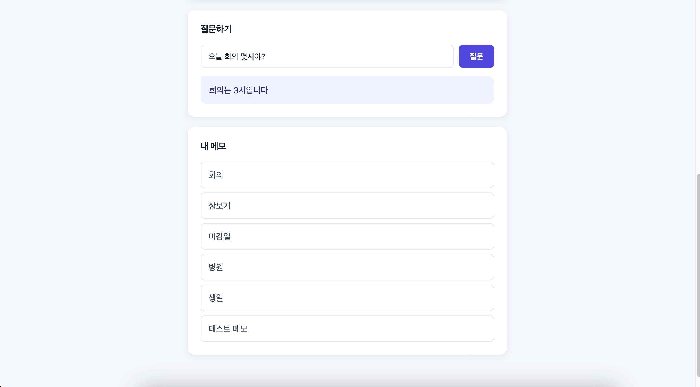

# Memo API

A FastAPI service that stores personal memos and answers natural-language questions about them
using RAG with a local LLM (Ollama). Includes JWT authentication with per-user memo isolation.

Ask a question in natural language and the app answers from your memos
(UI is in Korean: "오늘 회의 몇시야?" = "What time is today's meeting?" → "The meeting is at 3 PM").




## Features

- JWT authentication with registration and login
- Memo CRUD with per-user access control (other users' memos return 403)
- Natural-language Q&A over your memos using RAG with a local LLM
- 9 automated tests with pytest covering auth, permissions, and memo creation

## Tech Stack

- Backend: Python, FastAPI, Uvicorn
- Database: SQLite, SQLAlchemy
- Auth: JWT (python-jose), bcrypt (passlib)
- AI/RAG: Ollama (llama3.1:8b, kure-v1 embeddings), LangChain, Chroma
- Testing: pytest, httpx
- Frontend: React (CDN), JavaScript

## Getting Started

1. Install [Ollama](https://ollama.com) and pull the models
```bash
   ollama pull llama3.1:8b
   ollama pull daynice/kure-v1
```
2. Create a virtual environment and install dependencies
```bash
   python -m venv venv
   source venv/bin/activate
   pip install -r requirements.txt
```
3. Start the server
```bash
   uvicorn main:app --reload
```
4. Open the API docs at http://127.0.0.1:8000/docs
5. Open `frontend/app.html` in a browser for the React UI

## Running Tests

```bash
pytest
```

## Design Notes

### 1. Improving Korean RAG retrieval quality

**Problem**

I originally used `nomic-embed-text` as the embedding model, but retrieval returned memos that did not match the question.
For example, asking "장볼 때 뭐 사야 해?" ("What should I buy when grocery shopping?") returned a memo about a wallet.

**Investigation**

First, I checked whether the memo title was reflected in the embedding, and it was. Next, I checked whether a difference in phrasing between the question and the documents was the cause, and it was not.
Finally, I inspected the raw scores with `similarity_search_with_score` and concluded that the model itself was weak on Korean.

**Solution**

I switched to `daynice/kure-v1`, an embedding model specialized for Korean. Testing again with the same question, the correct memo was retrieved and the answer was accurate.

### 2. Per-user access control

**Problem**

The memo update and delete endpoints only required a login, so a user who knew a `memo_id` could access another user's memo.

**Solution**

If a memo's `user_id` differs from the currently logged-in user, the API returns 403 and blocks the access.

**Verification**

I created two test accounts and verified with pytest that updating or deleting another user's memo returns 403. The delete test also confirms that the memo still exists after the attempt.

### 3. Persisting embeddings instead of re-embedding on every question

**Problem**

Every time a question was asked, all memos were re-embedded and a new Chroma store was built from scratch, so response time grew as the number of memos increased.

**Measurement**

With 6 memos, the first question took about 9 seconds (including model loading), and repeating the same question for the 2nd and 3rd time took about 1 second.
With 100 memos, the first question took about 13 seconds, and the 2nd and 3rd attempts took about 3 seconds.
I compared the 2nd and 3rd values, since they do not include model loading.

**Solution**

Memos are now embedded once, when they are saved, and persisted in Chroma.
Each vector carries the `user_id` as metadata, and questions are searched with a `filter` so that only the user's own memos are retrieved.

**Result**

With 100 memos, the time per question dropped from about 3 seconds to about 1-2 seconds (measured with a stopwatch).
At question time only the question itself is embedded, so the embedding cost does not grow as the number of memos increases.

**Known limitation**

Most of the remaining time is answer generation by llama3.1:8b.
The generation model sometimes produces awkward Korean sentences. I left this as a separate issue that can be improved by swapping the model.
I have not measured with large datasets (thousands of memos or more).